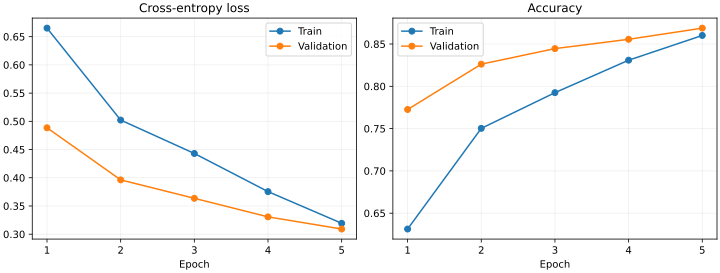
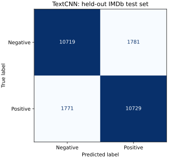

# IMDb sentiment analysis

[](https://github.com/ibra-0/imdb-sentiment-analysis/actions/workflows/checks.yml)
[](https://colab.research.google.com/github/ibra-0/imdb-sentiment-analysis/blob/main/notebooks/sentiment_analysis.ipynb)

Classify English movie reviews as positive or negative using **TextCNN in PyTorch**,
and compare it with TF-IDF + Naive Bayes and TF-IDF + a linear SVM.

Academic portfolio project by **Ibrakhim Razyyev**, developed from practical work
for **AI Fundamentals based on Huawei course materials** at KBTU.

## What this project demonstrates

- Text cleaning, train-only vocabulary construction and fixed-length token encoding.
- A TextCNN with learned embeddings and parallel convolutions of widths 3, 4 and 5.
- A shared-split comparison with classical machine-learning baselines.
- Validation-based checkpoint selection, held-out test evaluation and error analysis.
- Reusable training/inference code, a command-line interface and a runnable notebook.

## Results

Fresh full run recorded on **2026-11-21**, using `cpu`.
All models use the same **20,000 train / 5,000 validation / 25,000 test** reviews.
No test examples are used to fit the vocabulary or select the CNN checkpoint.

| Model | Validation accuracy | Test accuracy | Test macro F1 |
|---|---:|---:|---:|
| TF-IDF + Naive Bayes | 86.90% | 86.30% | 0.8630 |
| TF-IDF + Linear SVM | 90.30% | 88.88% | 0.8888 |
| TextCNN | 86.88% | 85.79% | 0.8579 |

TextCNN: 2,714,502 parameters, 5 epochs,
checkpoint selected at epoch 5 by lowest validation loss.
These are results for one fixed seed, not multi-run estimates or a claim of
state-of-the-art performance. Baselines use word uni/bigrams; TextCNN uses up
to 256 tokens. Those input differences are part of this small benchmark.




Full metrics, package versions, configuration and split hashes:
[`results/metrics.json`](results/metrics.json).

## Quick start

Use **Python 3.12**. CUDA, Apple MPS and CPU are supported through PyTorch;
`auto` selects an available accelerator. CPU training is slower.

```bash
git clone https://github.com/ibra-0/imdb-sentiment-analysis.git
cd imdb-sentiment-analysis
python -m venv .venv
source .venv/bin/activate
python -m pip install -r requirements.txt

# Full experiment: downloads IMDb and trains all three models.
python sentiment.py train --output runs/full

# Predict after training.
python sentiment.py predict --checkpoint runs/full/textcnn.pt \
  --text "A thoughtful and enjoyable movie."
```

On Windows, activate the environment with `.venv\Scripts\activate`.
For a small end-to-end functionality check:

```bash
python sentiment.py train --smoke --epochs 1 --device cpu --output runs/smoke
```

The smoke run uses **128 train / 64 validation / 64 test** reviews. Its results
are not the portfolio benchmark. Full dataset download still occurs on the first run.

For the notebook, use the **Open in Colab** button above or install
`requirements-dev.txt` and open `notebooks/sentiment_analysis.ipynb` in Jupyter/VS Code.
The notebook explores the committed results by default. Set `RUN_TRAINING = True`
to run new training. A new run saves its checkpoint under `runs/`.

## Model and experiment

```text
Review → clean + tokenize → learned embedding (128)
       → Conv1D widths 3/4/5 (100 filters each) + ReLU
       → global max pooling → dropout (0.5) → 2 logits
```

The vocabulary is capped at 20,000 entries, including PAD and UNK.
The CNN uses Adam (learning rate 0.001), batch size 64 and five epochs.
The best state is selected using validation cross-entropy.
Baselines use TF-IDF with at most 20,000 uni/bigram features and fixed default
classifier settings. There is no hyperparameter search over the test set.

The dataset is pinned to revision `e6281661ce1c48d982bc483cf8a173c1bbeb5d31`.
Seed 42 controls splitting, vocabulary/training order and initialisation.
Results may differ across PyTorch versions, hardware and numerical backends.
`requirements-tested.txt` records the direct versions used for this run;
`requirements.txt` gives supported version ranges rather than promising identical metrics.

## Limitations and next steps

- Truncation drops everything after token 256. Long reviews can lose important context.
- Short reviews, negation, mixed sentiment and sarcasm can produce mistakes.
- Softmax scores are not calibrated confidence estimates.
- The original max-pooling implementation includes padded positions. Masking those
  positions is a useful follow-up experiment.
- Validation covers English movie reviews, not Russian/Kazakh text or arbitrary business feedback.
- This is an educational model without a production deployment or a hosted API.

Example predictions from the recorded run appear in the
notebook and metrics JSON. Future work: padding-aware pooling, repeated-seed evaluation,
longer context and an optional FastAPI inference endpoint.

## Project structure

```text
sentiment.py                       # Training, baselines and prediction CLI
notebooks/sentiment_analysis.ipynb  # Guided walkthrough and optional retraining
results/                           # Fresh metrics and figures (no weights/data)
tests/test_sentiment.py             # Preprocessing, OOV handling and checkpoint checks
requirements*.txt                  # Runtime, development and tested dependencies
```

Datasets, local caches, checkpoints and secrets are excluded from Git.
No pretrained weights are bundled; train locally or in Colab to produce a checkpoint.

## Checks

```bash
python -m pip install -r requirements-dev.txt
python -m pytest -q
```

GitHub Actions runs the unit checks and notebook-format validation. It does not
retrain the full model. The notebook was also executed locally in results-viewing mode.

## Provenance and references

The original academic notebook combined RT-polarity baselines with an IMDb TextCNN.
This portfolio version keeps the TextCNN architecture and rebuilds the baselines
on IMDb so the comparison uses the same examples. Preparation added modular code,
documentation, reproducibility metadata and checks with AI assistance.

The original saved TextCNN output reported 85.47% test accuracy and 0.8544 macro F1.
Those historical values are not presented as the fresh benchmark above.
Original notebook: [Colab](https://colab.research.google.com/drive/1CMyEXJOfwXgATq-iDl6A1154DYiPLHeZ)
(its sharing permissions may restrict access).

- Maas et al. (2011), [Learning Word Vectors for Sentiment Analysis](https://aclanthology.org/P11-1015/).
- [IMDb dataset and original usage terms](https://ai.stanford.edu/~amaas/data/sentiment/).
- [Hugging Face dataset mirror](https://huggingface.co/datasets/stanfordnlp/imdb).
- Kim (2014), [Convolutional Neural Networks for Sentence Classification](https://aclanthology.org/D14-1181/).

The dataset is downloaded from its source, not redistributed in this repository.
This repository does not relicense Huawei course materials or third-party datasets.
